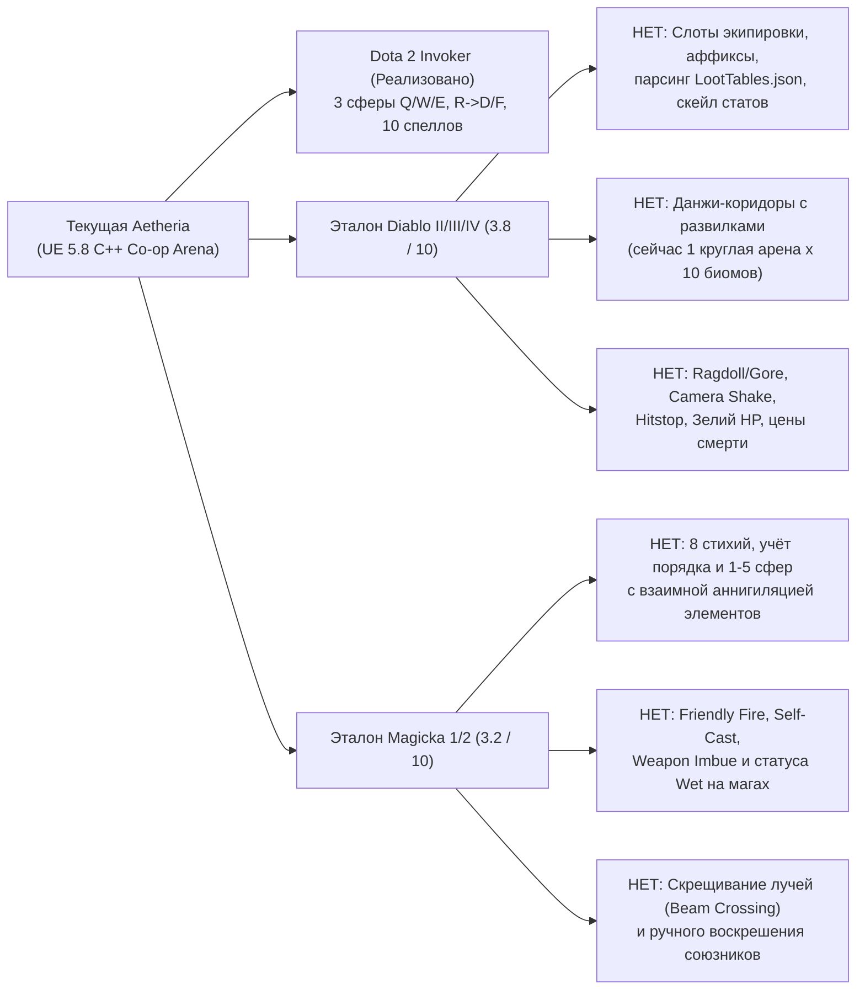

# Аудит игры AETHERIA: Shards of the Chrono-Seal — Сверка с Diablo и Magicka

**Дата аудита:** 16.11.2026  
**Объект оценки:** `c:\Users\user\Desktop\WizardGame` (UE 5.8 C++ модуль `Aetheria` + превью `_instant_exe_preview\Aetheria_DemoPreview.exe`)  
**Исполнитель:** Агент-оценщик (`agy-evaluator`)  

---

## 1. Итоговый вердикт и Scorecard

По фактическому устройству исходного кода `Source/Aetheria/` текущая **Aetheria** — это **аренный волновой кооперативный экшен на 1–6 игроков с системой синтеза заклинаний в духе Invoker из Dota 2** (`Q/W/E` сферы без учёта порядка → `R` → слоты `D/F`), а **не** алхимическая физическая песочница *Magicka* и **не** лут-ориентированный данжен-кроулер *Diablo*.

| Направление оценки | Балл | Краткое резюме |
|---|---:|---|
| **Инженерное ядро UE5.8 C++ и автоинициализация** | **8.2 / 10** | 15 пар `.h/.cpp`, 0 ошибок UHT/BOM, скомпилированы `Binaries/Win64`, Listen-сервер 1–6 игроков, AI-напарники, фаззер 10 000 шагов. |
| **Тактика боя и кросс-стихийные синергии** | **7.0 / 10** | Работают расщепление снарядов Призмой, поджиг Чёрной Дыры, Крио-Раскол, Термошок, Wall Slam, Aerial Juggle, High Ground, StaggerGauge босса. |
| **Соответствие эталону *Diablo (II / III / IV)*** | **3.8 / 10** | Есть изометрия и мрачные ассеты, но отсутствуют реальный лут/экипировка, данжи-коридоры, уникальные боссы, цена смерти, фляги/сферы HP и импакт смертей. |
| **Соответствие эталону *Magicka (1 / 2)*** | **3.2 / 10** | Вместо комбинаторики 8 стихий и 4 форм каста — строго 3 сферы Invoker. Ноль Friendly Fire, нет `Self-Cast`, `Weapon Imbue`, статуса `Wet` на магах и скрещивания лучей. |
| **Визуал и стандарт Mind Critic (по LookDev)** | **4.5 / 10** | Фотограмметрические плиты и вуалевая статуя соседствуют с примитивами блокаута (алтарь из куба и сфер, белые сферы вместо огня, 0/36 мешей героев/мобов). |



---

## 2. Сильные стороны текущей сборки (Плюсы)

1. **Самодостаточная C++ архитектура без ручной возни в Blueprints:**
   - Мир, пост-обработка, освещение Lumen/AgX, 10 биомов, рельефные зоны и интерфейс строятся напрямую из C++ на пустой карте `/Engine/Maps/Entry`.
   - Декорации и рельеф батчатся через `UInstancedStaticMeshComponent` в [AetheriaBiomeBuilder.cpp](file:///c:/Users/user/Desktop/WizardGame/Source/Aetheria/Private/AetheriaBiomeBuilder.cpp#L43-L107).
   - Строгий Slate HUD в стеклянно-бронзовой палитре (`MindBgGlass`, `BronzeFrameColor`) без аляповатого mobile-слопа, с двустраничным Гримуаром на `Tab` и Атласом на `M` ([AetheriaSlateHUD.cpp](file:///c:/Users/user/Desktop/WizardGame/Source/Aetheria/Private/AetheriaSlateHUD.cpp#L1055-L1150)).
2. **Два режима каста + буферизация ввода:**
   - Классический `InvokeThenAim` (`Q/W/E -> R -> D/F -> ЛКМ`) для фанатов Invoker и `InstantOnCombo` (каст сразу при наборе 3-й сферы) для быстрого входа новичков ([AetheriaWizardCharacter.cpp](file:///c:/Users/user/Desktop/WizardGame/Source/Aetheria/Private/AetheriaWizardCharacter.cpp#L919-L980)).
   - Рывок на `Space` с окном неуязвимости `0.28 с` ([AetheriaWizardCharacter.cpp](file:///c:/Users/user/Desktop/WizardGame/Source/Aetheria/Private/AetheriaWizardCharacter.cpp#L1025-L1054)).
3. **Реально работающие в C++ пространственные и статусные синергии:**
   - **Призма (`WEE`) + Снаряды:** расщепляет союзные `Fireball` и базовые снаряды на веер `×3` (`-18° / 0° / +18°`, `0.65x` урона) и поглощает вражеские выстрелы ([AetheriaSpellActors.cpp](file:///c:/Users/user/Desktop/WizardGame/Source/Aetheria/Private/AetheriaSpellActors.cpp#L287-L331)).
   - **Болид (`QQQ`) + Чёрная Дыра (`EEE`):** воспламеняет воронку в Солнечную Сингулярность (`TickDamage *= 1.35f`, смена визуала и ударная волна, [AetheriaSpellActors.cpp](file:///c:/Users/user/Desktop/WizardGame/Source/Aetheria/Private/AetheriaSpellActors.cpp#L279-L284), [L673-L693](file:///c:/Users/user/Desktop/WizardGame/Source/Aetheria/Private/AetheriaSpellActors.cpp#L673-L693)).
   - **Хроносфера (`WWW`) + Цепная Молния (`QWW`):** `+40%` резонанса по замороженным целям и `+20%` в мокрой низине `SunkenTrench` ([AetheriaWizardCharacter.cpp](file:///c:/Users/user/Desktop/WizardGame/Source/Aetheria/Private/AetheriaWizardCharacter.cpp#L1250-L1256)).
   - **Матрица статусных реакций мобов** ([AetheriaMobCharacter.cpp](file:///c:/Users/user/Desktop/WizardGame/Source/Aetheria/Private/AetheriaMobCharacter.cpp#L231-L672)): `Термошок`, `Крио-Раскол` (с казнью `Swarm < 18% HP`), `Wall Slam` (`+95` урона и `0.75 с` Stun об парапет `CoverParapet` или край арены), `Armor Melt` (до `+20%` / `+15%` боссу), `Aerial Juggle (+25%)`, `Exposed (+20%)` для оглушённых стрелков, Diminishing Returns на стан для `Bruiser` и шкала `StaggerGauge (0..100)` у босса с `2.2 с` Stagger Break (`+30%` урона).
   - **Укрытия и рельеф:** вражеские снаряды блокируются парапетами `CoverParapet`, а союзные летят над ними ([AetheriaSpellActors.cpp](file:///c:/Users/user/Desktop/WizardGame/Source/Aetheria/Private/AetheriaSpellActors.cpp#L244-L249)); возвышенности `ElevatedPlateau` дают `+15%` урона заклинаний и базовых атак ([AetheriaWizardCharacter.cpp](file:///c:/Users/user/Desktop/WizardGame/Source/Aetheria/Private/AetheriaWizardCharacter.cpp#L999), [L1111](file:///c:/Users/user/Desktop/WizardGame/Source/Aetheria/Private/AetheriaWizardCharacter.cpp#L1111)); низины замедляют на `18%`.
4. **Адаптивная режиссура волн и засад:**
   - `ThreatBudget` с `MercyFactor` (`0.75` при среднем HP отряда `< 35%`, `1.12` при `> 85%`, [AetheriaGameMode.cpp](file:///c:/Users/user/Desktop/WizardGame/Source/Aetheria/Private/AetheriaGameMode.cpp#L1270-L1281)).
   - Засады с честным телеграфом `0.85 с` до появления врагов (`TickPendingAmbushes`, [AetheriaGameMode.cpp](file:///c:/Users/user/Desktop/WizardGame/Source/Aetheria/Private/AetheriaGameMode.cpp#L1409-L1453)).
5. **Инженерная дисциплина:**
   - Скрипт [validate_ue5_project.py](file:///c:/Users/user/Desktop/WizardGame/Scripts/validate_ue5_project.py) проверяет UHT-макросы, `DOREPLIFETIME`, `_Implementation` и UTF-8 BOM; [verify_balance_and_loot.py](file:///c:/Users/user/Desktop/WizardGame/Scripts/verify_balance_and_loot.py) гоняет 10 000-шаговый фаззер и проверяет 19 синтезированных `.wav` звуков.

---

## 3. Детальная сверка с *Diablo (II / III / IV)*

| Критерий Diablo | Как в эталоне (Diablo II–IV) | Как сейчас в Aetheria | Вердикт |
|---|---|---|---|
| **Лут и экипировка** | Слоты (посох, броня, кольца, амулет), редкие аффиксы, билдообразующие легендарки | Муляж. `LootTables.json` в C++ не читается; выпадают только строки в баннер + XP/Essence | **Провал** |
| **Билдостроение и уровни** | Дерево навыков, руны, аспекты, парагон, ощутимый рост мощи с уровнем | Фиксированные 10 спеллов; `AwardProgression` даёт только `+18 MaxHP` за уровень (достижим ~L10 из 30) | **Провал** |
| **Архитектура мира** | Исследуемые коридоры, комнаты, подземелья, сундуки, шрайны, туман войны | Одна круглая арена с 5 волновыми актами; биомы 04–10 — один шаблон рельефа под углом `Index * 37°` | **Критично** |
| **Уникальность боссов** | Каждый актовый босс имеет 3 уникальные фазы, арену и сигнатурные механики | Все 10 боссов на одном классе `AAetheriaMobCharacter` с одним циклом `Slam` + `Meteor/Hole/EMP` | **Критично** |
| **Импакт боя и смерть врагов** | Ragdoll, расчленение/ожоги, трупы, Hitstop, Camera Shake, вылетающие цифры урона | HitFlash на материале + `Destroy()` в кадр смерти без тел, без анимаций, без Shake и цифр урона | **Слабо** |
| **Выживание (HP)** | Заряжаемые фляги исцеления + кровавые сферы с элиток/боссов | Зелий и сфер HP нет; лечение только от центра арены (`SanctuaryRing`, `+4 HP/с`) или щита `QWE` | **Недостаёт** |
| **Цена смерти** | Смерть штрафует или требует поднятия союзником; вайп сбрасывает энкаунтер | Мёртвый маг сам воскрешается каждые `3.0 с` с полным HP/Mana; проиграть невозможно | **Провал** |
| **Готика и свет** | Кьяроскуро PBR-сканы, факелы, кованое железо, цельный мрачный арт-дирекшн | Каменные плиты и статуя отличные, но алтарь/жаровни/существа из примитивов рушат иллюзию | **Половинчато** |

### Главные недостатки относительно *Diablo*
1. **Муляж лута и мёртвая экономика:**
   - [LootTables.json](file:///c:/Users/user/Desktop/WizardGame/Data/LootTables.json) вообще не загружается из C++. В [AetheriaGameMode.cpp](file:///c:/Users/user/Desktop/WizardGame/Source/Aetheria/Private/AetheriaGameMode.cpp#L1019-L1058) список реликвий захардкожен массивом строк (`"+12% Игнис"`, `"-10% кд Хроносферы"`), но при выпадении добавляется лишь немного XP и `ArcaneEssence`.
   - Поле `EquippedRelicNames` в [AetheriaSaveGame.h](file:///c:/Users/user/Desktop/WizardGame/Source/Aetheria/Public/AetheriaSaveGame.h#L33) нигде не заполняется и не читается — ни один бонус реликвии не влияет на урон, ману или перезарядку.
   - У валюты `ArcaneEssence` нет геймплейной точки траты (кроме косметики), а 10-локационная кампания даёт лишь ~`15 110 XP` (~10 уровень из 30).
2. **Одинаковая круглая арена и одинаковые боссы:**
   - Пол арены — единый куб `360×360×2` ([AetheriaBiomeBuilder.cpp](file:///c:/Users/user/Desktop/WizardGame/Source/Aetheria/Private/AetheriaBiomeBuilder.cpp#L33-L41)). Шаблон `BuildBiomeTerrainZones` ([AetheriaBiomeDatabase.cpp](file:///c:/Users/user/Desktop/WizardGame/Source/Aetheria/Private/AetheriaBiomeDatabase.cpp#L35-L133)) одинаков для локаций 04–10 и просто вращается на `Index * 37°`.
   - Все 10 боссов отличаются только табличными HP/Damage/цветом и крутят один `ExecuteBossSlam` + `ExecuteBossOrbSpell` ([AetheriaMobCharacter.cpp](file:///c:/Users/user/Desktop/WizardGame/Source/Aetheria/Private/AetheriaMobCharacter.cpp#L1434-L1520)).
3. **Недостаточный физический импакт и нулевая ставка на выживание:**
   - При смерти мобы исчезают за 1 кадр (`Destroy()` в [AetheriaMobCharacter.cpp](file:///c:/Users/user/Desktop/WizardGame/Source/Aetheria/Private/AetheriaMobCharacter.cpp#L1549)).
   - Безусловное авто-воскрешение магов через `3.0 с` ([AetheriaGameMode.cpp](file:///c:/Users/user/Desktop/WizardGame/Source/Aetheria/Private/AetheriaGameMode.cpp#L433-L466)) полностью убирает напряжение боя с боссом.

---

## 4. Детальная сверка с *Magicka (1 / 2)*

| Критерий Magicka | Как в эталоне (Magicka 1/2) | Как сейчас в Aetheria | Вердикт |
|---|---|---|---|
| **Элементы и комбинаторика** | 8 стихий, очередь 1–5 слотов, порядок и пропорции меняют свойства заклинания | 3 сферы (`Q/W/E`), строго 3 слота, порядок стирается сортировкой `NormalizeComboKey` (ровно 10 спеллов) | **Invoker, не Magicka** |
| **Взаимная аннигиляция стихий** | Вода+Молния=Пар/саморазряд, Огонь+Холод гасят друг друга, Жизнь vs Аркана | Отсутствует: новая сфера в `ServerPushOrb` просто выталкивает самую старую | **Отсутствует** |
| **Формы каста (Cast Shapes)** | Любой набор стихий можно пустить вперёд, в AoE вокруг себя, на себя или в оружие | Форма таргетинга жёстко зашита в `EAetheriaTargetShape` каждого из 10 спеллов | **Отсутствует** |
| **Friendly Fire (Огонь по своим)** | Полный урон, отбрасывание, заморозка и случайные убийства напарников | **0% Friendly Fire**. `DealDamageToMobOrActor` бьёт только мобов; `QWE` лечит/щитит союзников | **Полный антипод** |
| **Статусы на самих магах** | Намокание (`Wet`) + Молния = самоубийство; горение тушится Водой | Маг не может намокнуть, загореться или замёрзнуть от стихийных комбинаций | **Отсутствует** |
| **Скрещивание лучей (`Beam Crossing`)** | Два луча магов при встрече сливаются в нестабильную взрывную сферу | `SupernovaBeam` (`QQW`) никак не взаимодействует с другими лучами в коопе | **Отсутствует** |
| **Кооп-поддержка и воскрешение** | Заклинание `Revive (WA)` для срочного поднятия павшего друга в бою | Павшие друзья не нуждаются в помощи — игра сама поднимает их через 3 с | **Отсутствует** |

### Главный вывод по *Magicka*
Механика *Aetheria* ощущается как **Dota 2 Invoker PvE-арена**, а не *Magicka*. В ней есть отличная точность тактического контроля (Хроносфера, Призма, Чёрная Дыра), но **отсутствует эмерджентный хаос и физика взаимодействия магов друг с другом**, ради которых игроки любят *Magicka*.

---

## 5. Критические баги C++, эксплойты и дефекты ассетов

### [P0-BUG-1] Полный обход кулдаунов ультимейтов игроками и ботами
1. В `ServerInvoke_Implementation` ([AetheriaWizardCharacter.cpp](file:///c:/Users/user/Desktop/WizardGame/Source/Aetheria/Private/AetheriaWizardCharacter.cpp#L926-L933)) кулдауны хранятся в слотах `SlotD`/`SlotF`, а при вызове нового спелла выставляется `SlotDCooldownRemaining = 0.0f;` — ротация `WWW -> R -> D -> QQQ -> R -> WWW -> R -> D` позволяет кастовать 11.5-секундную **Хроносферу каждые полсекунды**!
2. В `ServerInstantCastCombo_Implementation` ([AetheriaWizardCharacter.cpp](file:///c:/Users/user/Desktop/WizardGame/Source/Aetheria/Private/AetheriaWizardCharacter.cpp#L965-L980)) проверка `Cooldown > 0` **отсутствует вообще** — в режиме мгновенного каста спелл ограничивается только маной.
3. Боты в [AetheriaBotAIController.cpp](file:///c:/Users/user/Desktop/WizardGame/Source/Aetheria/Private/AetheriaBotAIController.cpp#L281-L282) вызывают `MyWizard->ExecuteSpellServer(SpellId, TargetLocation);` напрямую, полностью минуя списание маны и установку КД в `SlotD`/`SlotF`.

### [P0-BUG-2] Ваншот боссов на `35% MaxHP` и каскадная рекурсия в `Thermal Shock`
В `AAetheriaMobCharacter::SetChronoFrozen(true)` ([AetheriaMobCharacter.cpp](file:///c:/Users/user/Desktop/WizardGame/Source/Aetheria/Private/AetheriaMobCharacter.cpp#L632-L656)):
```cpp
const float ThermalShockDmg = MaxHP * 0.35f;
...
OtherMob->ApplySpellDamage(ThermalShockDmg, LastInstigator.Get(), true, 0.0f);
```
Если босса сначала поджечь, а затем накрыть Хроносферой, он мгновенно теряет **35% максимального здоровья** (до **7 700 урона** одним заклинанием у финального босса на 22 000 HP!), а передача `bIgnite = true` в `OverlapMultiByChannel` вызывает цепной поджиг окружающих мобов.

### [P1-BUG-3] Огрехи сетевой синхронизации и статических переменных
- `static int32 LootPityCounter` ([AetheriaGameMode.cpp](file:///c:/Users/user/Desktop/WizardGame/Source/Aetheria/Private/AetheriaGameMode.cpp#L1016)) и `static int32 SpellCycle` ([AetheriaMobCharacter.cpp](file:///c:/Users/user/Desktop/WizardGame/Source/Aetheria/Private/AetheriaMobCharacter.cpp#L1468)) объявлены как process-wide `static` переменные (не сбрасываются при рестарте матча и делятся между инстансами).
- `ServerInvoke` проигрывает звук `SFX_Invoke` только под `if (IsLocallyControlled())` ([AetheriaWizardCharacter.cpp](file:///c:/Users/user/Desktop/WizardGame/Source/Aetheria/Private/AetheriaWizardCharacter.cpp#L935-L938)) — без `Multicast`/`OnRep` удалённые клиенты его не слышат; `OnRep_ActiveOrbs` озвучивает только последнюю сферу при пакетном приходе RPC.
- Клиентского предсказания спавна снарядов и `Lag Compensation` нет.

### [P1-BUG-4] Разрыв между `_instant_exe_preview` и UE5, пустые 3D-слоты (`0/36`)
- `_instant_exe_preview\Aetheria_DemoPreview.exe` ([Aetheria_DemoPreview.cs](file:///c:/Users/user/Desktop/WizardGame/_instant_exe_preview/Aetheria_DemoPreview.cs)) запускает не UE5-сборку, а старый Node/Three.js веб-прототип в окне Microsoft Edge `--app`.
- Проверка `verify_balance_and_loot.py` показала: **11 базовых мешей готовы, но 0 из 36 целевых слотов (`SM_Hero_00..09`, `SM_Boss_Loc00..09`, `SM_Mob_*`) не заполнены**. Папки `Content/` нет — в рантайме меши откатываются к базовым геометрическим примитивам `/Engine/BasicShapes/`.

### [P1-ART-5] Визуальный аудит по стандарту Mind Critic
По реальным рендерам и иллюстрациям в проекте:
- [LookDev_Diablo_Check.png](file:///c:/Users/user/Desktop/WizardGame/RawAssets/LookDev_Diablo_Check.png): плитка пола, валуны и рифлёные колонны дают добротную мрачную базу, но алтарь собран из грубого куба и двух гладких шаров, вместо огня в жаровнях висят белые сферы, а маркер клика на земле слишком яркий и плоский.
- [LookDev_HollowMagus_3070.png](file:///c:/Users/user/Desktop/WizardGame/RawAssets/LookDev_HollowMagus_3070.png): центральная вуалевая скульптура выглядит сильно и атмосферно, однако окружение слева/справа провалено в черноту с примитивной геометрией рогов/птицы и резкими плоскими полигонами свечения.
- [SpellPlate_01.png](file:///c:/Users/user/Desktop/WizardGame/RawAssets/Grimoire/SpellPlate_01.png), [SpellPlate_02.png](file:///c:/Users/user/Desktop/WizardGame/RawAssets/Grimoire/SpellPlate_02.png), [T_GrimoireBookSpread.png](file:///c:/Users/user/Desktop/WizardGame/RawAssets/Grimoire/T_GrimoireBookSpread.png): карточки заклинаний Гримуара выглядят как программная 2D-графика с простыми кругами-линиями и радиальным градиентом, не дотягивая до гравюр тёмного фэнтези.

---

## 6. Дорожная карта для Общего Штаба (P0 → P1 → P2)

### Приоритет P0 — Починить боевую честность и сломанный цикл игры
1. **Единая таблица кулдаунов по `EAetheriaSpellId` (`TMap<EAetheriaSpellId, float>`):** убрать сброс КД при `Invoke`, добавить проверку КД в `ServerInstantCastCombo`, обязать `BotAIController` тратить ману и запускать реальный КД.
2. **Фикс `Thermal Shock`:** заменить `MaxHP * 0.35f` в `SetChronoFrozen` на `180.0f * 0.35f` (или урон от источника с капом по боссам) и убрать `bIgnite = true` из вторичного AoE.
3. **Настоящий ARPG-лут и трата `ArcaneEssence`:** распарсить `Data/LootTables.json` в C++, задействовать `EquippedRelicNames`, реально применять статы реликвий (`+12% Игнис`, `-10% КД Хроносферы` и т.д.) в расчётах урона/КД/маны, сделать кузню/алтарь прокачки за Эссенцию и скейл урона от `WizardLevel`.
4. **Цена смерти и выживание:** убрать безусловный 3-секундный респаун — добавить `Party Wipe` (поражение и рестарт акта при гибели всех магов), ручное воскрешение союзника в бою и заряжаемую флягу/сферы исцеления.
5. **Убрать `static` счётчики** (`LootPityCounter`, `SpellCycle`) в поля `GameMode` / `MobCharacter` и починить репликацию звука `SFX_Invoke`.

### Приоритет P1 — Сближение с *Magicka* и *Diablo* по геймплею
1. **Элементы *Magicka* в коопе:**
   - Опциональный тумблер лобби **Friendly Fire (`0% / 35% / 100%`)**;
   - **Скрещивание лучей (`Beam Crossing`)**, когда два мага сводят `SupernovaBeam` в одной точке → нестабильный плазменно-гравитационный взрыв;
   - Модификатор **Self-Cast (`Alt` / `СКМ`)** для быстрого наложения эффектов/щита на себя и физические статусы (`Wet` / `Burning` / `Chilled`) на самих магах.
2. **Элементы *Diablo* в мире и боссах:**
   - Выделить хотя бы 2–3 связных зала/коридора на локацию вместо одной круглой арены;
   - Дать каждому из 10 боссов минимум 1 уникальную сигнатурную механику вместо единого `ExecuteBossOrbSpell`.

### Приоритет P2 — Визуал уровня *Diablo IV* / *Mind*
1. Заполнить 36 целевых меш-слотов (`SM_Hero_*`, `SM_Boss_Loc*`, `SM_Mob_*`) ригнутыми моделями, добавить анимации или шейдер растворения в пепел (`Dissolve`) при смерти мобов, `Camera Shake` и `Hitstop` (`30–50 мс`) на тяжёлых заклинаниях (`ChaosMeteor`, `PrimalOverload`, `Stagger Break`).
2. Пересобрать примитивные алтарь/жаровни/фамильяра из [LookDev_Diablo_Check.png](file:///c:/Users/user/Desktop/WizardGame/RawAssets/LookDev_Diablo_Check.png) и [LookDev_HollowMagus_3070.png](file:///c:/Users/user/Desktop/WizardGame/RawAssets/LookDev_HollowMagus_3070.png), добавить живое пламя и перерисовать пластины Гримуара под стиль офортной гравюры.
