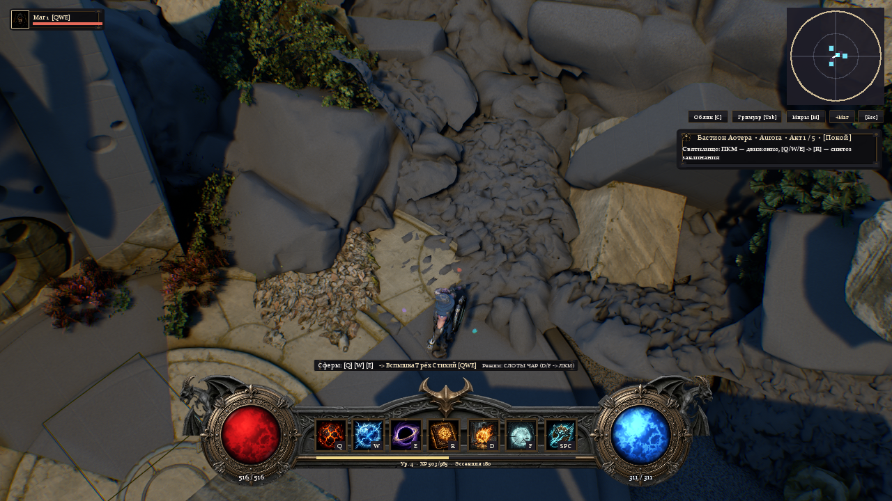

# AETHERIA: Shards of the Chrono-Seal

Изометрическая dark-fantasy action RPG на **Unreal Engine 5.8 (C++)** в духе Diablo IV — волшебник с тремя стихиями, 16 заклинаний из комбинаций сфер, волны врагов, босс с тремя фазами, кооп до 6 игроков с AI-компаньонами.



## Геймплей

- **ЛКМ** — движение, **ПКМ** — автоатака, **Space** — рывок
- **Q / W / E** — сферы Огня / Молнии / Пустоты
- **R** — комбинирует три активные сферы в одно из **16 заклинаний** (стихия + роль), результат кладётся в слоты **D / F**
- 4 типа врагов (swarm/bruiser/ranged/boss), босс с 3 фазами, лут с pity-таймером, реликвии, акты, смерть/возрождение (соло — самореспавн, в коопе — подъём союзника)

## Миры

Бастион Аотера (пепел и базальт) · Руины Монолита (мох и обломки) · Святилище Архонта (мрамор и кристаллы) · Порог Пустоты (обсидиан и эфириальные трещины) — плюс живой 3D-двор в главном меню.

## Архитектура (23 C++ класса, без Blueprints-логики)

- `AetheriaGameMode` — волны/акты/босс/лут, ground-watchdog (герой не может провалиться сквозь землю: трассировка + удержание + спасение)
- `AetheriaWizardCharacter` — инпут, сферы, касты, камера Diablo-типа (pitch −55°, arm 1650, occluder-fade стен)
- `AetheriaAnimInstance` — процедурная локомоция по скорости (клипы Paragon Gideon), стрейф, каст-хореография
- `AetheriaSpellDatabase` / `AetheriaSpellActors` — 16 заклинаний, VFX
- `AetheriaWorldDirector` — арт-дирекшн каждого мира: свет, туман, экспозиция, палитры
- `AetheriaCookRefs` — data-asset с жёсткими ссылками на весь динамически-грузимый контент (решает проблему cook-by-reference в упаковке)
- `AetheriaSlateHUD` — Diablo-стиль HUD на Slate (сферы жизни/маны, гримуар, инвентарь), русский язык

## Запуск

```bat
:: Полная сборка (требуется UE 5.8 + VS2022):
Build_UE5_EXE.bat
:: Быстрый запуск (exe, иначе editor -game):
PLAY_UE5_NOW.bat
```

Автотесты (окно/-RenderOffscreen, самозакрытие):
`-GrokGroundTest` (спавн-вердикт по каждому миру) · `-GrokCombatTest` (орбы→R→D/F + волны) · `-GrokWorldShot` (скриншот мира)

## Репозиторий

Здесь исходники, скрипты сборки/тестов, документация и собственные ассеты (карты миров, материалы, AI-арт). **Мегабайтные Fab/Paragon-паки в репо не входят** (лицензия Epic) — движок подхватит их из вашей локальной библиотеки Fab: Paragon (Gideon, Grux, Khaimera, Sevarog, Morigesh, Aurora, Minions, Props), MedievalDungeon, KiteDemo, Gothic Environment, Vefects, Portals, Stylish Fire VFX и др.

## Генерация ассетов

Кинематографичные скайбоксы/PBR-наборы биомов/кей-арт — сгенерированы image-моделью (`Scripts/gen_cinematic_assets.py`, `Scripts/derive_pbr_maps.py`), производные normal/roughness/emissive карты считаются из альбедо локально.

---
*Проект в активной разработке. Не аффилирован с Blizzard/Epic; Paragon-ассеты — по лицензии Epic Content Agreement (использование только внутри Unreal Engine).*
